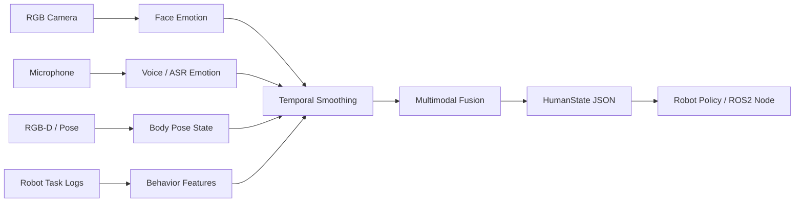

# RehabAffectPerception

面向康复陪伴机器人的人类情绪与状态感知模块。项目目标不是“读心”或医学诊断，而是从视觉、语音、姿态和交互行为中估计用户的康复交互状态，并把结果提供给机器人上层策略。

## Project Goal

在残障陪伴与康复训练场景中，机器人需要根据用户状态调整交互方式。例如用户疲劳时降低训练强度，用户困惑时重复说明，用户疑似不适时暂停并提醒护理人员。本项目构建一个轻量的人类状态感知模块：

```text
RGB / RGB-D camera + microphone
    -> face, voice, pose, text and task-behavior signals
    -> temporal smoothing and multimodal fusion
    -> human_state with confidence
    -> robot interaction policy
```

## State Labels

第一版不直接做“七分类情绪”，而是面向康复交互定义更实用的状态：

| Label | Meaning | Robot Response |
| --- | --- | --- |
| `engaged` | 积极配合 | 继续任务并正向反馈 |
| `neutral` | 正常 | 保持当前交互 |
| `confused` | 困惑 | 放慢语速，重复说明 |
| `fatigued` | 疲劳 | 降低训练强度，询问是否休息 |
| `frustrated` | 烦躁/抗拒 | 暂停催促，降低交互压力 |
| `discomfort` | 疑似疼痛/不适 | 立即暂停，询问并提醒护理人员 |
| `low_attention` | 注意力下降 | 重新吸引注意力或简化任务 |
| `need_help` | 需要帮助 | 提供协助或呼叫护理人员 |

同时输出连续情绪维度：

```text
valence: 情绪正负，范围 [-1, 1]
arousal: 激活程度，范围 [0, 1]
confidence: 置信度，范围 [0, 1]
```

## MVP Architecture



## Repository Layout

```text
docs/
  project_plan_zh.md        项目方案与面试讲法
  data_schema_zh.md         数据采集和标注格式
src/rehab_affect/
  schema.py                 核心数据结构
  smoothing.py              多帧平滑逻辑
  fusion.py                 多模态规则融合逻辑
  demo.py                   不依赖模型权重的模拟 demo
configs/
  labels.json               状态标签配置
data/
  README.md                 数据目录说明
```

## Quick Demo

```bash
cd D:/GIT/RehabAffectPerception
python -m src.rehab_affect.demo
```

输出示例：

```json
{
  "person_id": "user_001",
  "state": "fatigued",
  "valence": -0.35,
  "arousal": 0.22,
  "confidence": 0.78,
  "evidence": ["face", "voice", "task_behavior"],
  "suggested_robot_action": "slow_down_and_offer_break"
}
```

## Roadmap

1. 第一版：摄像头/麦克风输入 + 公开模型特征 + 时间平滑 + JSON 输出。
2. 第二版：采集康复交互短片段，建立标注规范和主动学习流程。
3. 第三版：接入 ROS2 / WebSocket，把 `human_state` 传给机器人上层策略。
4. 第四版：结合 VLA/PI policy，让机器人动作根据用户状态自适应调整。

