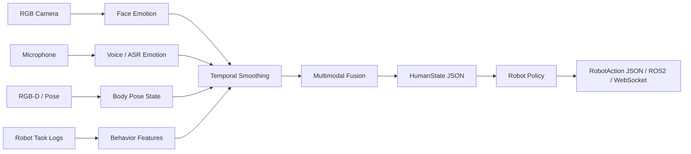

# RehabAffectPerception

> **辅读学校课堂分析 Demo 源码归档**

本仓库同时保留两条代码线：早期的具身智能/学生状态感知基础工程，以及后续 Demo1、Demo2 的课堂视频分析平台。当前阅读和测试课堂分析代码时，建议先看下面四份材料：

1. [全版本目录](docs/demo_version_catalog_zh.md)：按时间列出 V01-V24、功能、源码位置、证据等级和恢复边界。
2. [GitHub 逐版本推送方案](docs/github_versioning_plan_zh.md)：说明为什么历史版本逐版保留，而云端只保留最后一版。
3. [Doc2 查漏补缺清单](docs/doc2_gap_check_zh.md)：把截图中的 10 类功能映射回已有版本，不虚构新版本。
4. [Demo2 主线交付记录](docs/demo2_mainline_delivery_and_followup_20261021.md)：说明当前云端主线、已完成能力和后续补齐顺序。
5. [版本 PDF 归档](docs/version_pdfs/README.md)：按 V01-V24 归档版本说明、功能展示和交付 PDF。
6. [公开归档清单](docs/public_archive_manifest_zh.md)：记录已纳入、未纳入和格式化电脑后的恢复方法。

## 从哪里开始

### 当前课堂视频分析主线

当前最终云端版本的最短流程是：

```text
登录 -> 填少量课程信息 -> 上传视频 -> 后台解码与分析 -> 查看最多 3 个人物的状态时间轴 -> 查看报告/下载结果
```

对应的主要模块：

| 模块 | 入口 | 作用 |
| --- | --- | --- |
| 登录与学校入口 | `src/rehab_affect/demo2_entry.py`、`demo2_portal.py` | 登录、学校课程、上传任务和任务列表 |
| 真实媒体处理 | `demo2_media_analysis.py`、`demo2_media_worker.py` | 视频解码、音轨提取、采样帧和分析任务 |
| 人物跟踪与状态 | `demo2_student_tracking.py`、`demo2_simple_result.py` | 最多 3 个匿名人物、独立证据帧、时间轴和状态线索 |
| 学生身份与档案 | `demo2_identity.py`、`demo2_identity_store.py`、`student_record_store.py` | 姓名绑定、学生档案和课堂历史的高级能力 |
| IEP 与资料授权 | `demo2_dossier.py`、`demo2_dossier_store.py`、`demo2_dossier_vault.py` | 资料摘要、授权、版本、期限和撤回 |
| 评分与双轨评价 | `assessment_rubric.py`、`classroom_rubric.py`、`demo2_evaluation.py` | 0-10 分、学校轨、系统增强轨和差异说明 |
| 公司后台 | `demo2_channel_admin.py`、`demo2_portal.py` | 任务、处理状态、存储和结果下载 |

当前最终云端源码证据位于 `.runtime/cloud_candidate_tracking_20261022_v2/`，该目录只作为本机部署留痕，不能直接公开上传；公开仓库使用 `src/rehab_affect/` 中的脱敏源码。

### 早期 Demo1 核心

Demo1 的单学生课堂状态时间轴是历史基线，主要看：

- `src/rehab_affect/seewo_student_demo.py`
- `src/rehab_affect/seewo_long_report.py`
- `dist/RehabAffect_Seewo_Student_Demo_Offline_20260727/` 和 `20260731/` 中的离线源码包

它依赖固定学生区域和示例材料；不能把它直接解释为任意新视频都能自动识别姓名。Demo2 后续把流程扩展为通用上传、匿名人物、权限、后台和多学校任务，因此出现了“Demo1 有、后面看起来没有”的版本差异，具体原因见版本目录。

## 版本导航

| 范围 | 内容 |
| --- | --- |
| V01-V07 | 基础工程、课堂演示、Demo1 单学生时间轴、离线源码包 |
| V08-V12 | 三学生 Demo2、页面交付、档案/资料/四通道源码包 |
| V13-V16 | 真实媒体、身份、IEP、评分、双轨评价和课程工作台 |
| V17-V20 | 四通道、公司后台、学生档案、长期留存和维护 |
| V21-V22 | 云端迁移、上传修复、课堂与学生结果候选过程 |
| V23 | `cloud-final-v3.2-20261022`，当前唯一正式云端版本 |
| V24 | 户外/高清测试补充，归入 V23，不新增云端版本 |

## 运行前提

基础模拟 Demo：

```bash
python -m src.rehab_affect.demo
python -m src.rehab_affect.mvp --mode mock --steps 10
```

课堂平台的本地入口：

```powershell
.\start_school_demo2.cmd
```

具体环境变量、测试账号和部署方式不要写入公开仓库；请使用本机私有配置或管理员交付材料。当前仓库没有把公网账号、密码、邀请密钥、API Key、学生档案、真实视频或分析数据库作为公开代码提交。

## 公开边界

本项目是工程 Demo 和研究验证代码，不是医学诊断工具，也不能据此宣称真实姓名自动识别、IEP 自动正确绑定、特殊教育评分准确率或教师判断替代已经完成。真实学校数据必须经过授权，原始视频、IEP、诊断资料和人脸图像不能进入公开 Git 历史。

面向辅读学校辅助机器人的多模态人类状态感知与动作决策模块。项目目标不是“读心”、普通情绪分类或医学诊断，而是从视觉、语音、姿态、课堂任务表现和历史状态中估计学生在学习/训练交互中的状态，并把结构化 `human_state` 和最终 `robot_action` 提供给机器人上层策略。

## Project Goal

在辅读学校和特殊教育支持场景中，机器人需要根据学生状态调整交互方式。例如学生困惑时分步骤重复说明，疲劳或压力升高时降低任务负荷，明确拒绝时暂停并询问意愿，疑似不适时停止动作并提醒教师或照护者。本项目构建一个轻量的人类状态感知与具身动作决策模块：

```text
RGB / RGB-D camera + microphone
    -> face, voice, pose, text and task-behavior signals
    -> temporal smoothing and multimodal fusion
    -> human_state with confidence
    -> robot_action for speech, motion, task adjustment, and safety handoff
```

## State Labels

第一版不直接做“七分类情绪”，而是面向辅读学校课堂/训练交互定义更实用的状态：

| Label | Meaning | Robot Response |
| --- | --- | --- |
| `engaged` | 积极配合 | 继续任务并正向反馈 |
| `neutral` | 正常 | 保持当前交互 |
| `confused` | 困惑 | 放慢语速，重复说明 |
| `fatigued` | 疲劳/任务负荷过高 | 降低任务负荷，询问是否休息 |
| `frustrated` | 挫败/烦躁 | 暂停催促，降低交互压力 |
| `refusing` | 抗拒/拒绝继续 | 暂停，询问意愿并提供选择 |
| `pain_risk` | 疑似疼痛/不适风险 | 立即暂停，询问并提醒教师或照护者 |
| `low_attention` | 注意力下降 | 重新吸引注意力或简化任务 |
| `needs_help` | 需要帮助 | 提供协助或呼叫教师/照护者 |

同时输出连续情绪维度：

```text
valence: 情绪正负，范围 [-1, 1]
arousal: 激活程度，范围 [0, 1]
confidence: 置信度，范围 [0, 1]
```

## MVP Architecture



## Repository Layout

```text
docs/
  project_plan_zh.md        项目方案与面试讲法
  data_schema_zh.md         数据采集和标注格式
  special_education_solution_design_zh.md  辅读学校实地需求结合现有原型的设计方案
  mvp_integration_zh.md     MVP 模块与 ROS2/WebSocket 接入方案
  two_month_embodied_ai_roadmap_zh.md  两个月具身智能项目路线图
  two_month_embodied_ai_roadmap.xlsx   两个月路线图 Excel 打卡表
  embodied_model_strategy_zh.md        OpenPI/pi0/pi0.5 具身模型接入策略
  special_education_benchmark_zh.md    辅读学校 MuJoCo/Isaac Sim benchmark 设计
  evaluation_report_zh.md              benchmark 评估报告
  demo_script_zh.md                    3 分钟演示脚本
  seewo_student_demo_readme_zh.md      Seewo 单学生追踪 Demo 截图说明
src/rehab_affect/
  schema.py                 核心数据结构
  inputs.py                 摄像头、麦克风和模拟输入
  recognizers.py            多模态轻量识别器/模型接入占位
  smoothing.py              多帧平滑逻辑
  fusion.py                 多模态规则融合逻辑
  policy.py                 human_state 到机器人动作的规则策略
  learned_policy.py         本地可训练的具身动作策略 baseline
  pipeline.py               输入到 human_state 的 MVP pipeline
  train_policy.py           从 benchmark 场景训练动作策略
  sim_runner.py             辅读学校 benchmark 场景运行器
  closed_loop.py            机器人动作反馈到下一步学生状态的闭环仿真
  closed_loop_report.py     闭环具身 benchmark 报告导出器
  demo_launcher.py          本地演示总入口页生成器
  policy_compare.py         rule/raw learned/shielded learned 策略对比
  demo_export.py            静态 HTML 展示页生成器
  interactive_console.py    交互式 benchmark 控制台导出器
  robustness_eval.py        多 seed 随机扰动鲁棒性评估
  precloud_release.py       云电脑前本地最终版一键生成器
  scenario_lab_server.py    本地可编辑 Scenario Lab 服务
  mujoco_snapshot.py        MuJoCo 场景截图导出器
  websocket_server.py       WebSocket benchmark 事件推送
  ros2_mock_publisher.py    Windows 本地 ROS2-style JSONL mock
  demo.py                   不依赖模型权重的模拟 demo
  mvp.py                    JSONL 输出命令行入口
  assessment_rubric.py      0--10评分、6分及格线、维度权重与长期趋势契约
  media_capture.py          摄像头/麦克风硬件预检与采集结果契约
configs/
  labels.json               状态标签配置
  objects.json              辅读学校场景对象配置
  scenarios/                辅读学校 benchmark 场景
data/
  README.md                 数据目录说明
```

## 评课评分与长期测量

整改后的统一口径见 `docs/assessment_and_longitudinal_spec_zh.md`：每次课使用 0--10 分，6 分为及格；综合分由正确性（35%）、独立程度（30%）、一致性（20%）和迁移（15%）组成。学生页的长期数据按每次课、每周、每月和滚动 60 天聚合，证据不足显示为空档，不按 0 分处理。视频/音频硬件采集先做可用性预检，采集失败不会生成学生评分。

## Quick Demo

```bash
cd D:/GIT/RehabAffectPerception
python -m src.rehab_affect.demo
```

运行第一版 MVP 模拟流：

```bash
python -m src.rehab_affect.mvp --mode mock --steps 10
python -m src.rehab_affect.mvp --mode mock --steps 3 --pretty --include-signals
```

接入本机摄像头/麦克风前先安装可选输入依赖：

```bash
pip install -e ".[input]"
python -m src.rehab_affect.mvp --mode live --camera --microphone --steps 20
```

`--mode live` 不指定 `--camera` 或 `--microphone` 时默认两者都启用；只想测试单一路径时可单独传其中一个参数。

运行辅读学校 benchmark：

```bash
python -m src.rehab_affect.sim_runner --scenario-dir configs/scenarios --summary-only --pretty
python -m src.rehab_affect.sim_runner --scenario configs/scenarios/pain_risk_safety.json --pretty
```

第一版默认使用轻量 `kinematic` 后端，保证本地稳定运行；后续接 MuJoCo 时安装：

```bash
pip install -e ".[simulation]"
python -m src.rehab_affect.sim_runner --backend mujoco --scenario configs/scenarios/pain_risk_safety.json --pretty
```

训练本地具身动作策略 baseline：

```powershell
pip install -e ".[training,simulation]"
python -m src.rehab_affect.train_policy `
  --scenario-dir configs/scenarios `
  --output models/learned_school_policy.pkl `
  --metrics-output data/processed/learned_policy_metrics.json `
  --benchmark-backend mujoco `
  --augmentations-per-scenario 8 `
  --eval-ratio 0.25 `
  --seed 123 `
  --pretty
```

用学习策略运行 MuJoCo benchmark：

```powershell
python -m src.rehab_affect.sim_runner `
  --backend mujoco `
  --policy learned `
  --model-path models/learned_school_policy.pkl `
  --scenario-dir configs/scenarios `
  --summary-only `
  --pretty
```

生成展示页：

```powershell
python -m src.rehab_affect.demo_export `
  --backend mujoco `
  --policy learned `
  --model-path models/learned_school_policy.pkl `
  --output outputs/special_education_benchmark_demo.html
```

启动 30 日学校沟通用 AI 助教 Demo：

```powershell
python -m src.rehab_affect.scenario_lab_server --host 127.0.0.1 --port 8791 --policy rule
```

打开：

```text
http://127.0.0.1:8791/education_demo
```

该页面演示“视频识别头 1 / 视频识别头 2 / 语音识别头 -> 时间线融合 -> 人物状态库 -> 教师端、学生端和机器人动作 JSON 输出”的完整闭环。当前使用公开课堂视频风格的匿名模拟切片，不含真实学生隐私；取得校方授权后替换为真实抽帧、ASR 与教师校准标签。

生成交互式控制台：

```powershell
python -m src.rehab_affect.interactive_console `
  --backend mujoco `
  --policy learned `
  --model-path models/learned_school_policy.pkl `
  --scenario-dir configs/scenarios `
  --compare-backend kinematic `
  --output outputs/interactive_benchmark_console.html
```

生成闭环动作反馈 benchmark 报告：

```powershell
python -m src.rehab_affect.closed_loop_report `
  --scenario-dir configs/scenarios `
  --backend kinematic `
  --policy learned `
  --model-path models/learned_school_policy.pkl `
  --json-output data/processed/closed_loop_benchmark.json `
  --html-output outputs/closed_loop_benchmark_report.html `
  --pretty
```

对比规则策略、原始学习策略、带 shield 学习策略：

```powershell
python -m src.rehab_affect.policy_compare `
  --backend kinematic `
  --model-path models/learned_school_policy.pkl `
  --scenario-dir configs/scenarios `
  --augmentations-per-scenario 2 `
  --output data/processed/policy_comparison.json `
  --pretty
```

生成云电脑前本地最终版：

```powershell
python -m src.rehab_affect.precloud_release `
  --benchmark-backend mujoco `
  --compare-backend kinematic `
  --release-manifest outputs/precloud_release_manifest.json `
  --final-report docs/final_precloud_report_zh.md `
  --pretty
```

生成演示总入口页：

```powershell
python -m src.rehab_affect.demo_launcher `
  --manifest outputs/precloud_release_manifest.json `
  --output outputs/demo_index.html `
  --pretty
```

启动课堂展示页和可编辑 Scenario Lab：

```powershell
python -m src.rehab_affect.scenario_lab_server `
  --host 127.0.0.1 `
  --port 8787 `
  --scenario-dir configs/scenarios `
  --model-path models/learned_school_policy.pkl `
  --policy learned
```

打开：

```text
http://127.0.0.1:8787/showcase
http://127.0.0.1:8787
http://127.0.0.1:8787?preset=pain
http://127.0.0.1:8787?scenario=shape_sorting_confused&loop=1
```

其中 `/showcase` 是面向汇报展示的一屏闭环入口：学生端任务、仿真课堂、教师端状态、`human_state`、`robot_action` 和整节课闭环报告会同时显示。

然后打开：

```text
outputs/special_education_benchmark_demo.html
```

导出 MuJoCo 场景截图：

```bash
python -m src.rehab_affect.mujoco_snapshot --scenario configs/scenarios/pain_risk_safety.json --output-dir outputs/mujoco_frames
```

运行 WebSocket 接口 demo：

```powershell
pip install -e ".[websocket]"
python -m src.rehab_affect.websocket_server `
  --backend mujoco `
  --policy learned `
  --model-path models/learned_school_policy.pkl `
  --scenario-dir configs/scenarios `
  --host 127.0.0.1 `
  --port 8765
```

生成 ROS2-style mock topic 日志：

```powershell
python -m src.rehab_affect.ros2_mock_publisher `
  --backend mujoco `
  --policy learned `
  --model-path models/learned_school_policy.pkl `
  --scenario-dir configs/scenarios `
  --output data/processed/ros2_mock_messages.jsonl
```

本地阶段生成的主要展示产物：

```text
models/learned_school_policy.pkl
data/processed/learned_policy_metrics.json
outputs/demo_index.html
outputs/special_education_benchmark_demo.html
outputs/interactive_benchmark_console.html
outputs/closed_loop_benchmark_report.html
outputs/playwright/interactive_benchmark_console.png
outputs/playwright/scenario_lab.png
outputs/playwright/scenario_lab_pain_risk.png
outputs/playwright/scenario_lab_closed_loop.png
outputs/playwright/classroom_showcase.png
outputs/playwright/classroom_showcase_closed_loop.png
outputs/playwright/classroom_showcase_mujoco.png
outputs/playwright/classroom_showcase_mujoco_closed_loop.png
outputs/mujoco_frames/pain_risk_safety_contact_sheet.png
data/processed/policy_comparison.json
data/processed/robustness_eval.json
data/processed/closed_loop_benchmark.json
outputs/precloud_release_manifest.json
docs/final_precloud_report_zh.md
data/processed/websocket_stream_sample.jsonl
data/processed/ros2_mock_messages.jsonl
```

输出示例：

```json
{
  "human_state": {
    "person_id": "user_001",
    "state": "fatigued",
    "confidence": 0.78,
    "evidence": ["face", "voice", "task_behavior"],
    "risk_level": "medium",
    "recommended_robot_action": "reduce_task_load_and_offer_break",
    "handoff_required": false
  },
  "robot_action": {
    "action_id": "reduce_task_load_and_offer_break",
    "speech_action": "offer_break",
    "motion_policy": "slow_down",
    "task_adjustment": "reduce_task_load",
    "safety_action": "monitor_fatigue",
    "priority": "medium"
  }
}
```

## 学校内测平台

双击 `start_school_demo2.cmd` 后，默认进入：

```text
http://127.0.0.1:8791/demo2/login
```

这是本机测试地址，不是公网网站。当前内测门户包含独立登录页、4 个账号隔离的视频上传工作台、公司数据后台和原有课堂分析页。每个学校上传账号固定绑定一个通道，每个账号在同一课程下默认可创建 5 个视频任务；浏览器按 4MB 分片上传。原视频按 60 天策略保存，并在到期前 15 天进入后台提醒。

测试账号由项目方预置，不开放公共注册。首次初始化可通过环境变量 `REHAB_DEMO2_ACCOUNT_PASSWORD_PREFIX` 设置开发密码前缀，通过 `REHAB_DEMO2_COURSE_UPLOAD_LIMIT` 将每课程名额设置为 3 至 5。默认内测凭据见 `docs/demo2_internal_test_accounts_zh.md`，部署到局域网或云端前必须更换。

## Roadmap

1. 内测平台：账号登录、4 通道隔离、课程名额、分片上传、进度、保存期限和公司后台。
2. 数据闭环：课程、学生、IEP、视频、教师复核和报告统一绑定到课程批次。
3. 模型服务：人物追踪、姿态行为、语音识别、互动事件和时间序列融合，异步生成可复核证据。
4. 学校试点：以真实授权数据验证召回率、误报率、教师复核一致性和端到端处理时延。
5. 部署扩展：PostgreSQL、对象存储、任务队列、备份、监控、HTTPS 和学校租户隔离。
6. 动作接口：将经教师确认的支持建议输出为屏幕、语音或硬件插件可消费的动作指令。
