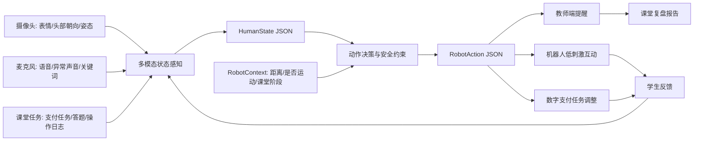

# 辅读学校具身智能课堂辅助与生活技能训练系统设计方案

## 1. 方案定位

本方案基于辅读学校听课观察、会后教师交流，以及当前 `RehabAffectPerception` 已完成的多模态状态感知与机器人动作决策原型，设计一个面向辅读学校真实课堂的具身智能辅助系统。

一句话定位：

```text
面向辅读学校的多模态课堂状态感知、低刺激机器人互动与生活化任务训练系统。
```

系统不以“机器人替代教师”为目标，也不做医学诊断，而是通过摄像头、麦克风、课堂任务记录和机器人/屏幕交互，辅助教师更早发现学生状态变化，并在安全、克制、可关闭的前提下进行低刺激互动和生活技能训练。

核心价值链路：

```text
课堂观察
  -> 多模态学生状态感知
  -> human_state
  -> 教师提示 + robot_action
  -> 低刺激互动 / 生活技能任务调整
  -> 学生反馈
  -> 闭环复盘报告
```

## 2. 与已有工作的结合方式

当前项目已经具备一个可运行的技术底座：

| 已有模块 | 当前能力 | 在本方案中的作用 |
| --- | --- | --- |
| `schema.py` | 定义 `HumanState`、`RobotContext`、`RobotAction` | 作为课堂状态和机器人动作的统一数据合同 |
| `recognizers.py` | 轻量表情、语音文本、姿态、任务行为识别 | 对接摄像头、麦克风、任务日志的第一版感知接口 |
| `fusion.py` / `smoothing.py` | 多模态融合与时间平滑 | 避免单帧误判，输出稳定课堂状态 |
| `policy.py` / `learned_policy.py` | 状态到机器人动作的规则/学习策略 | 把状态判断落到具体机器人动作 |
| `sim_runner.py` | 辅读学校场景 benchmark | 先在仿真场景中验证动作策略 |
| `closed_loop.py` | 动作反馈到下一步学生状态 | 体现具身智能闭环，不只是分类识别 |
| `closed_loop_report.py` | 闭环 benchmark 报告 | 评估策略是否改善学生状态和安全性 |
| `scenario_lab_server.py` | 本地可编辑 Scenario Lab | 展示“改学生线索 -> 输出机器人动作”的交互原型 |
| `websocket_server.py` / `ros2_mock_publisher.py` | WebSocket 与 ROS2-style mock | 后续接机器人控制端和教师端系统 |

因此，本方案不是从零开始，而是在已有底座上扩展两个应用层：

1. **课堂状态感知与低刺激互动层**：延续当前 `human_state -> robot_action` 主链路。
2. **数字支付生活技能训练层**：新增“货币/扫码支付/虚拟余额/购物任务”场景，把课堂任务表现纳入状态感知和闭环反馈。

## 3. 真实课堂需求到系统模块的映射

| 听课与交流得到的需求 | 产品模块 | 可复用已有能力 | 需要新增能力 |
| --- | --- | --- | --- |
| 学生注意力短、容易乱动、状态不稳定 | 课堂状态感知 | `low_attention`、姿态/任务行为识别、时间平滑 | 增加 `overactive`、`vocal_outburst`、`gaze_disengaged` 等课堂状态标签 |
| 老师希望早发现情绪波动 | 情绪与参与度辅助观察 | `frustrated`、`refusing`、`needs_help`、风险等级 | 教师端趋势图、状态复盘报告 |
| 眼神互动重要 | 视线/头部朝向参与度识别 | 摄像头输入接口、`evidence` 字段 | 头部朝向、看向老师/屏幕/机器人/材料的轻量识别 |
| 注意力需要被拉回 | 低刺激机器人互动 | `robot_action.motion_policy`、`speech_action`、`safety_action` | 分级干预策略、老师一键开关、刺激强度配置 |
| 纸币课与现实支付脱节 | 数字支付生活技能训练 | task_behavior、scenario benchmark、closed_loop | 虚拟超市、扫码支付、余额变化、支付错误检测 |
| 学生能力差异大 | 分层任务与个体化策略 | task difficulty、domain randomization | 学生分层档案、任务难度自适应 |
| 数据敏感 | 数据安全与伦理边界 | JSON 输出可脱敏、mock 数据优先 | 授权流程、数据脱敏、只采指标不采原始视频的方案 |

## 4. 产品总体架构



## 5. 核心功能设计

### 5.1 课堂状态感知

第一版建议保留当前项目已实现的核心状态，同时扩展更贴合辅读课堂的标签。

已实现状态：

| 状态 | 含义 | 对应动作 |
| --- | --- | --- |
| `engaged` | 专注参与 | 继续任务并鼓励 |
| `confused` | 困惑/没听懂 | 慢速重复说明、简化下一步 |
| `fatigued` | 疲劳/任务负荷高 | 降低任务负荷、询问休息 |
| `frustrated` | 挫败/烦躁 | 降低压力、避免反复催促 |
| `refusing` | 抗拒继续 | 暂停并确认意愿 |
| `pain_risk` | 不适或疼痛风险 | 停止运动并通知教师 |
| `low_attention` | 注意力下降 | 重新吸引注意，必要时停止运动 |
| `needs_help` | 需要帮助 | 提供帮助并通知教师 |

建议新增课堂状态：

| 新状态 | 含义 | 主要线索 | 动作建议 |
| --- | --- | --- | --- |
| `overactive` | 精力过旺、坐不住 | 姿态变化频繁、离座倾向、动作幅度大 | 降低刺激，给出短动作任务，提示教师关注 |
| `vocal_outburst` | 怪叫或异常发声 | 突然高音量、非任务相关发声 | 暂停语音刺激，提示教师判断 |
| `gaze_disengaged` | 视线脱离课堂任务 | 长时间不看老师/材料/屏幕 | 低刺激视觉提示或机器人朝向提示 |
| `task_stuck` | 任务卡住 | 长时间无操作、连续错误 | 简化任务、一步一步引导 |

注意：这些状态只作为“课堂辅助观察”，不作为医学结论。

### 5.2 低刺激机器人互动

机器人动作要分级，避免过度刺激。

| 等级 | 触发条件 | 动作 |
| --- | --- | --- |
| Level 0 | 状态正常或置信度低 | 只记录，不打扰 |
| Level 1 | 轻度注意力下降 | 屏幕轻提示、图标提示 |
| Level 2 | 视线短暂脱离 | 机器人转向学生或屏幕，不靠近 |
| Level 3 | 困惑/任务卡住 | 慢速重复说明、简化任务 |
| Level 4 | 抗拒、不适、异常行为 | 暂停互动，提示教师介入 |

动作输出可沿用已有 `RobotAction`：

```json
{
  "action_id": "regain_attention",
  "speech_action": "regain_attention",
  "motion_policy": "stop_motion",
  "task_adjustment": "simplify_next_step",
  "safety_action": "confirm_attention_before_motion",
  "handoff_required": false
}
```

### 5.3 数字支付生活技能训练

这是本次听课最明确的应用落点。建议设计为“虚拟小超市 + 纸币/数字支付过渡训练”。

训练链路：

```text
认识纸币
  -> 识别数字金额
  -> 商品价格匹配
  -> 选择支付方式
  -> 扫码/输入金额
  -> 虚拟余额变化
  -> 判断是否多付/少付/误付
  -> 课堂报告
```

任务样例：

| 任务 | 学生操作 | 系统判断 | 机器人/屏幕反馈 |
| --- | --- | --- | --- |
| 买一瓶水 2 元 | 选择 2 元纸币或输入 2 | 金额正确 | 正向反馈，进入下一题 |
| 买面包 5 元，余额 3 元 | 尝试付款 | 余额不足 | 提示“还差 2 元” |
| 商品 6 元，支付 10 元 | 支付过多 | 需要找零 | 提示“应找回 4 元” |
| 扫码金额 8 元但商品 5 元 | 误付风险 | 金额不一致 | 停止支付并提示确认 |

这个模块可以作为当前 benchmark 的新场景：

```text
configs/scenarios/payment_training_confused.json
configs/scenarios/payment_overpay_warning.json
configs/scenarios/payment_low_attention.json
configs/scenarios/payment_refusal_respect.json
```

## 6. 与现有 Demo 的结合展示

现有项目可以直接作为方案里的“技术原型展示”：

| 展示入口 | 说明 |
| --- | --- |
| `outputs/demo_index.html` | 本地演示总入口 |
| `http://127.0.0.1:8787` | 可编辑 Scenario Lab |
| `http://127.0.0.1:8787?preset=pain` | 疼痛/不适风险安全动作演示 |
| `http://127.0.0.1:8787?scenario=shape_sorting_confused&loop=1` | 困惑学生经过机器人说明后恢复参与的闭环演示 |
| `outputs/closed_loop_benchmark_report.html` | 闭环动作反馈 benchmark 报告 |
| `data/processed/closed_loop_benchmark.json` | 可复查的闭环实验数据 |

当前 demo 已能说明三件事：

1. 系统能把课堂线索融合成 `human_state`。
2. 系统能把状态落到具体 `robot_action`。
3. 机器人动作会反馈到下一步学生状态，形成具身闭环。

下一步要做的是把“数字支付生活技能训练”作为新的课堂任务接入这条链路。

## 7. MVP 试点方案

### 7.1 试点场景

建议先选择一个可控场景：

```text
三年级生活数学 / 货币与数字支付认知课
```

试点目标：

1. 帮助学生理解纸币、数字金额、商品价格和扫码支付之间的关系。
2. 观察学生在支付任务中的注意力、困惑、抗拒、需要帮助等状态。
3. 让机器人/屏幕以低刺激方式进行提示。
4. 给教师提供每节课的任务完成情况和状态变化报告。

### 7.2 设备配置

第一版设备尽量轻：

| 设备 | 用途 |
| --- | --- |
| 笔记本或小主机 | 运行感知与任务系统 |
| 普通摄像头 | 观察头部朝向、姿态、课堂参与度 |
| 麦克风 | 识别关键词、异常音量、简单语音线索 |
| 平板/大屏 | 虚拟超市和支付训练界面 |
| 可选机器人 | 低刺激朝向、语音提示、任务反馈 |

### 7.3 第一版流程

```text
老师选择学生与任务难度
  -> 学生进入虚拟小超市
  -> 系统给出购买任务
  -> 学生选择纸币/扫码/输入金额
  -> 系统记录任务行为
  -> 感知模块判断 student_state
  -> robot_action 给出提示/暂停/求助
  -> 生成课堂报告
```

### 7.4 教师端报告

每节课输出：

| 报告项 | 含义 |
| --- | --- |
| 任务完成率 | 学生是否完成支付任务 |
| 金额理解错误 | 少付、多付、误扫、余额不足 |
| 注意力下降次数 | 课堂参与度变化 |
| 困惑/卡住次数 | 是否需要分步骤教学 |
| 机器人提示次数 | 系统介入强度 |
| 教师介入建议 | 哪些时刻需要教师关注 |

## 8. 技术路线

### 8.1 本地原型阶段

目标：基于现有项目完成“支付训练场景 + 状态感知 + 动作建议”的 demo。

任务：

1. 新增支付训练场景 JSON。
2. 新增 payment task behavior 特征。
3. 扩展 `RobotAction` 的任务调整策略，例如 `confirm_amount`、`show_balance_change`、`request_teacher_help`。
4. 在 Scenario Lab 中加入支付任务预设。
5. 导出支付训练报告。

### 8.2 真实课堂试点阶段

目标：不采集敏感原始数据或只在授权范围内采集，先验证教师是否觉得有用。

数据优先级：

1. 任务日志：付款是否正确、耗时、错误类型。
2. 教师标注：注意力下降、困惑、需要帮助等事件。
3. 可选匿名特征：头部朝向、音量变化、姿态变化。
4. 谨慎采集原始视频/音频，必须获得学校和家长授权。

### 8.3 云电脑 / Isaac Sim 阶段

目标：把当前 MuJoCo 粗仿真升级成高保真辅读学校教室。

升级内容：

1. Isaac Sim 辅读学校教室。
2. 机器人、学生、老师、桌椅、超市货架、支付屏幕。
3. 摄像头第一视角和俯视视角。
4. 支付任务事件流和状态变化。
5. ROS2 bridge 接入真实或仿真机器人控制端。

## 9. 安全与伦理边界

必须写入方案正文：

1. **不做医学诊断**：系统只提示“可能注意力下降/可能需要帮助”，不判断疾病或障碍类型。
2. **不替代教师**：最终判断、干预和教育决策由教师负责。
3. **不主动接触学生**：机器人不得主动触碰学生，不快速靠近学生。
4. **低刺激原则**：避免突然大声、强光闪烁、快速动作和复杂指令。
5. **教师可控**：所有提示、声音、机器人动作必须可关闭、可暂停、可调整强度。
6. **数据最小化**：优先采集任务日志和匿名特征，采集视频/音频必须获得授权。
7. **隐私保护**：不公开展示学生原始影像，不把课堂视频随意用于宣传。

## 10. 分阶段合作路径

### 阶段一：公益课与需求共创

目标：

```text
进入学校、建立信任、观察课堂、确认真实痛点。
```

形式：

1. 机器人体验课。
2. 数字支付生活技能体验课。
3. 科技融合教育活动。
4. 教师访谈与需求共创。

### 阶段二：支付训练 MVP

目标：

```text
完成一个可演示、可试课、可记录数据的数字支付训练系统。
```

输出：

1. 虚拟小超市。
2. 支付任务脚本。
3. 状态感知原型。
4. 低刺激提示策略。
5. 教师端课后报告。

### 阶段三：小范围试运行

范围：

```text
一个班 / 一个年级 / 一类生活技能任务 / 2-4 周
```

评价指标：

1. 学生是否更愿意参与。
2. 支付任务正确率是否提升。
3. 注意力维持时间是否改善。
4. 教师是否觉得减少了观察和提醒压力。
5. 是否出现过度刺激或安全问题。

### 阶段四：数据驱动迭代

迭代方向：

1. 调整状态标签。
2. 调整提示强度。
3. 调整任务难度。
4. 加入个体化学习路径。
5. 扩展到点餐、乘车、问路、整理物品等生活技能。

## 11. 对外汇报表述

推荐表述：

```text
本项目不是让机器人替代教师上课，而是将具身智能用于辅读学校课堂中的辅助观察、低刺激互动和生活技能训练。系统通过多模态感知识别学生的注意力、困惑、抗拒、需要帮助等课堂状态，并输出结构化 human_state 和 robot_action，让机器人或屏幕以安全、克制、可控的方式辅助教师完成注意力唤回和任务引导。第一阶段重点落在数字支付生活技能训练，因为它直接对应学生未来社会自立、自理和融合能力。
```

简历/项目版：

```text
设计并实现了一个面向辅读学校辅助机器人的多模态课堂状态感知与具身动作决策原型，支持 human_state 结构化输出、robot_action 安全策略、闭环仿真评估、WebSocket/ROS2-style 接口，并扩展到数字支付生活技能训练场景。
```

## 12. 下一步落地任务

建议下一步按“小步可运行”推进：

1. 新增 `payment_training` 场景配置。
2. 扩展 `TaskBehavior` 支持金额、余额、支付错误类型。
3. 新增支付任务动作策略：确认金额、提示余额、提醒多付/少付。
4. 在 Scenario Lab 中加入“虚拟超市支付”预设。
5. 生成支付训练 demo 页面和报告。
6. 准备一页教师访谈问题清单，用于下次回访确认试点边界。
